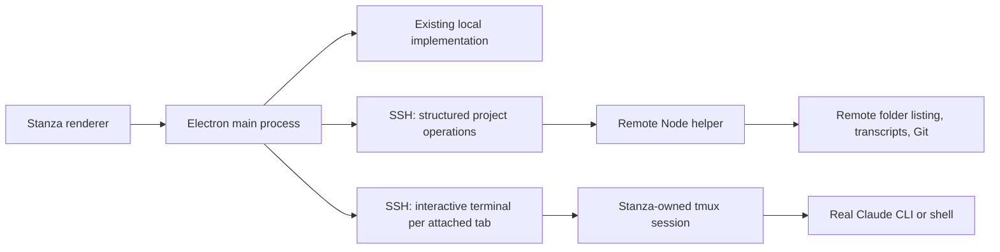

# Remote projects over SSH

Plan dated 26 October 2026, revised after an independent subagent review and implemented on
`codex/remote-projects`. Signed-in Claude conversations and Mac runtime verification remain pending.

## Goal

Use Stanza on Windows or macOS to work in a project folder on an Ubuntu server. The first
release covers real remote Claude/shell terminals, reconnect, session history, and Git status
and Changes. Code and development tools run on Ubuntu. Files stay on the server.

The supplied Codex screenshots guide the interaction: choose a device when adding a project,
then show that device beside the project name. Stanza keeps its existing design tokens and
compact rows. This does not add a Linux desktop build of Stanza.

## Verified environment

Read-only SSH checks against `aalish@g5-server` succeeded using the computer's existing SSH
configuration and trusted host key. Tailscale reports the server online. No settings, packages,
project files, or running sessions were changed.

| Item | Observed |
| --- | --- |
| Server | `g5-server`, Linux, user home `/home/aalish` |
| Shell | `/bin/bash` |
| Claude Code | `2.1.310`, available on the login shell's PATH |
| Claude authentication | Not logged in; remote login is required before starting Claude work |
| Node.js | `v24.22.1` |
| Session persistence | `tmux 3.6` installed |
| Other tools | Git, Python 3, `ss`, `lsof`, `ps`, SFTP server available |
| Candidate folder roots | `/home/aalish/development`, `/home/aalish/projects`, `/home/aalish/shared` |
| Transcript directory | `~/.claude/projects` absent; treat this as normal before first use |

The initial sandbox could not resolve the hostname or access Tailscale's local service.
The same checks outside that sandbox succeeded. This does not indicate a server configuration problem.

## Proposed experience

1. **Add project** opens a compact dialog with an optional project name and a device selector.
   The selector contains **This computer**, saved remote devices such as **G5 server**, and
   **Add remote…**. Each Stanza project continues to represent one folder on one device.
2. **Add remote** accepts a display name and SSH target, initially `G5 server` and
   `aalish@g5-server`. An optional port can be provided; existing SSH aliases supply other
   options. Stanza tests the connection and reports missing tools or remote Claude login.
3. **This computer** uses the existing native folder picker, including multiple-folder selection.
   A remote device opens a small remote folder picker with a path field, breadcrumbs, parent
   navigation, and directory rows. Start at the remote home, with hidden folders initially hidden.
4. A remote project appears in the existing sidebar with a small remote-folder icon and muted
   `G5 server` text. A separate connection indicator uses the existing semantic colors and a
   tooltip; it must remain distinct from Claude's working/attention indicator. Show connection
   errors as text in the relevant dialog or terminal overlay, not by color alone.
5. Opening a session starts the real remote `claude` in that folder. Shell sessions open the
   remote user's shell and are labelled **Shell**. Slash commands, permissions, model selection,
   and authentication remain Claude Code's own behavior.
6. Local and remote projects coexist, including in split view. The focused pane determines the
   project context. Status text includes `G5 server · /home/aalish/...`.
7. Existing project menus offer reconnect. Device rename/remove actions have been removed at
   the user's request; device management belongs in a later settings change. A target or account
   change creates a new connection identity. The folder picker can create one child directory.

All new controls follow `DESIGN.md` in dark, light, Claude dark, and Claude light. Preserve
keyboard navigation, focus restoration, Escape behavior, and the existing shortcut registry.

## Architecture

Use the operating system's **OpenSSH client**, a small **Node helper over SSH**, and **tmux**.

OpenSSH already handles the user's keys, agent, config aliases, jump hosts, and known hosts.
Remote commands and terminal allocation are documented in the
[OpenSSH manual](https://man.openbsd.org/ssh.1). Reusing it avoids a new SSH dependency and a
second credential store. Tailscale remains the network transport; Stanza needs no Tailscale API.

### Terminal connection and persistence

- Use the existing local node-pty/xterm path to run `ssh -tt` and attach to a remote tmux
  session. Terminal bytes stay out of the JSON control protocol.
- Give Stanza its own tmux socket and configuration. Each remote tab gets a stable random
  session handle. Do not inherit the user's tmux key bindings or status bar, and never operate
  on unrelated tmux sessions. Disable SSH's terminal escape key so it cannot consume prompt text.
- Explicitly configure terminal colors, mouse forwarding, key forwarding, and dimensions.
  Preserve Claude's fullscreen behavior, selection, Option/Alt keys, and Ctrl shortcuts.
- Launch Claude with constructed arguments, including validated resume UUIDs, fork, and the
  existing skip-permissions option. Resolve the remote login environment with a timeout.
- Obtain the remote pane PID, then use remote process ancestry and Claude's live session record
  to follow `/resume` and `/clear`. A local SSH PID is never the remote Claude PID.
- Reconnecting attaches to the existing tmux handle. It must not start another Claude process
  on the same transcript. Refuse attachment to a session owned by another live client with an
  actionable message; a cross-client takeover workflow is deferred.
- Separate **detach attachment**, **terminate runtime**, and **attach-or-start** operations.
  The current `ptyKill` is used by close, relaunch, and startup cancellation, so it cannot simply
  become remote detach. Relaunch must terminate the remote runtime and await confirmed process
  exit before starting Claude on that transcript again. Failure to confirm exit blocks relaunch.
- Opening a history row checks for an existing owned remote runtime before starting `--resume`.
  Resolve simultaneous attach/start requests once per device/project/session. An SSH attachment
  exiting is a transport event, not evidence that the remote Claude process exited.
- Treat tmux compatibility as the first implementation gate: validate the real fullscreen CLI
  before building the rest of the feature. If that fails, revisit the transport design rather
  than accepting broken terminal interaction.

tmux is intended to preserve remote programs across connection drops and later reattachment;
see its [getting-started guide](https://github.com/tmux/tmux/wiki/Getting-Started).
This covers dropped SSH connections, not server shutdown or reboot.

### Remote project operations

- Maintain one structured `ssh -T` control connection per connected device, shared by its
  projects. A versioned Node helper communicates over stdin/stdout using bounded JSON messages
  with request IDs, deadlines, and a protocol handshake. Diagnostic logs use stderr.
- During explicit remote setup, upload the bundled helper and required shared modules into a
  versioned Stanza-owned directory under `~/.local/share/stanza/remote/`. Use atomic writes.
  No root access, remote npm install, listening network service, or systemd unit is needed.
- Require Node 20+, tmux and util-linux's standard flock command for this Ubuntu implementation. Detect missing tools and give
  actionable setup instructions instead of silently installing system dependencies.
- Implement explicit operations for directory listing, owned runtime lifecycle, session
  summaries/live identity, and Git status/diff. Remote command
  arguments are constructed in trusted code; the renderer cannot supply shell command strings.
- Reuse existing pure transcript, diff, and UI parsers. Extract only the I/O code needed to
  share those parsers; do not introduce a general provider/plugin framework.
- Match existing file-size limits, cache by remote mtime/size, return summaries or changes, and
  avoid repeatedly downloading complete transcripts. Bound concurrency and response sizes so
  large diffs cannot block terminal interaction.
- Pause UI-driven polling while the window is hidden. Keep only connection maintenance and
  session lifecycle work required by an attached terminal.
  Add reconnect backoff and skip overlapping requests.
- Isolate local polling from each remote device during normal operation, not just startup.
  Existing all-project `Promise.all` handlers and shared renderer busy flags cannot hold local
  results behind a remote timeout. Deliver local results independently, use per-device deadlines
  and in-flight state, and ignore late results from a previous connection generation. Keep the
  last remote result marked stale when that device is offline.

### SSH authentication and errors

The first release supports existing key/agent-based SSH access, including Tailscale SSH where
already configured. Background connections use batch mode and never wait invisibly for a password.
The user's current connection already works this way.

Keep normal host-key verification. A new host or locked key gets an explicit setup action in
an interactive SSH terminal, followed by another connection test. A changed host key blocks
connection and shows SSH's error. Do not implement fingerprint acceptance by scraping terminal
prompts, disable host checking, store passwords, or enable agent forwarding automatically.

Readiness distinguishes SSH access, helper readiness, and Claude login. Offer **Open remote
terminal to sign in** for Claude login; keep credentials on the server and recheck afterward.
Respect existing aliases through OpenSSH itself rather than trying to reproduce its config parser.

## Project identity and saved state

Today `project.path` is both a filesystem path and a key throughout main, preload, and renderer.
Local `samePath()` also uses the desktop OS's path rules and lowercases paths. These assumptions
must be removed from remote call sites before remote projects are exposed in the UI.

- Persist devices as `{ id, name, target, port? }`; the name is chosen when adding a device.
  Device rename/removal controls are deferred to settings. A different endpoint/account gets a new device ID;
  do not carry its old runtime handles or caches across. Validate the server/account handshake
  before reusing a saved runtime, including after an SSH alias is reconfigured.
- Keep local project records compatible. Remote projects use `remoteId`, `remotePath` (the
  absolute case-sensitive POSIX path) and `path` (an opaque `ssh://device-id/encoded-path` key).
  This keeps existing local saved keys and renderer lookups compatible without normalizing
  Ubuntu paths on the desktop. `remoteKey()` builds and validates that identity.
- Use that identity for tabs, splits, expanded rows, ordering, Git caches, session lists,
  duplicate-session guards, document tabs, image caches, server ownership, and restore state.
  Two devices may have the same path, and Linux folders differing only in case stay distinct.
- Remote filesystem operations use remote path handling. Never pass `/home/...` through Windows
  `path.resolve`, local `fs`, Explorer/Finder, or the local VS Code file-opening fallback.
- Track remote runtime handles separately from Claude transcript UUIDs. A fresh session must
  remain reconnectable before it writes its first transcript.
- Keep the existing rule that only visible tabs/splits restore onto the workspace. Detached
  remote sessions remain discoverable under their projects, including sessions without a
  transcript. Discover and reconcile them when the device reconnects.
- Restore local tabs immediately. Preserve offline remote entries and show reconnect state;
  do not drop them because a synchronous local existence check fails or hold up local startup.
- Remote clock differences must not affect session ownership matching. Prefer authoritative
  remote PIDs/live records and server-side timestamps rather than desktop-time heuristics.

## Disconnect, close, and recovery behavior

| Event | Proposed behavior |
| --- | --- |
| Brief outage or client sleep | Show reconnecting; remote work stays in tmux; reconnect with backoff |
| Stanza quits or updates | Detach remote terminals; remote work continues |
| Close a remote tab | Detach; tooltip/menu explains that remote work keeps running |
| End remote session | Explicit action ends only that owned session, using graceful shutdown first |
| Remote Claude exits | Show Resume / New session using the existing overlay behavior |
| Server reboots or tmux session disappears | Explain that the live process ended; offer transcript resume |
| Offline project at startup | Keep the project, history cache, and restore entry; offer reconnect |
| Helper disconnects but terminal survives | Mark project metadata stale; do not report Claude as exited |

Do not queue terminal keystrokes while disconnected or replay a prompt after reconnecting.
Treat attachment loss, intentional detach, confirmed remote process exit, and failed
termination as separate outcomes. Closing during startup must either cancel creation or
retain the resulting owned runtime in discovery; it must not create an invisible orphan.

Adapt `onCloseRequest` and main's shutdown path: local work retains its current behavior;
remote work must not be listed as something quitting will stop. An explicit end request that
fails offline is reported as unconfirmed, never as successful. Do not kill by process name.

## First-release scope

| Feature | Initial release behavior |
| --- | --- |
| Claude/shell tabs, splits, shortcuts | Same interaction, running on the selected server |
| Session history, resume, fork, titles | Read remote transcripts; preserve live identity and duplicate guards |
| Git and Changes | Execute Git remotely; reuse the existing diff data/rendering and size limits |
| Running servers / forwarding | Deferred; show that remote server integration is unavailable |
| Markdown tabs | Deferred for remote projects; CLI-based file editing remains available |
| File links / Open in VS Code | Defer editor integration; offer Copy remote path |
| Explorer/Finder actions | Replace with Copy remote path |
| Image gallery | Deferred for remote projects |
| Text paste | Normal terminal paste |
| File drop / clipboard image | Clear unsupported message; never paste a local path or send local image-paste escape sequences |
| Session model/effort/subagent information | Basic model from session summaries where available; rich metadata deferred |
| Account usage and activity totals | Keep existing local scope explicit; do not present local totals as remote totals |
| MCP / agent definitions | Deferred; never substitute local data in the remote project context |

Deferred surfaces need explicit remote guards before release. Background polling must not
call local MCP, agents, images, docs, file resolution, or port ownership with a remote path.
Local-only footer information must remain labelled as local. Existing local features retain
their behavior when a local pane is focused.

Users can start development servers in the remote terminal, but Stanza does not discover or
forward them in this release. For now, access uses the user's existing Tailscale/network or
manually configured SSH forwarding. Remote `localhost` is not the desktop's `localhost`.

File upload, server discovery/forwarding, remote markdown editing, and VS Code Remote - SSH
are separate follow-ups. Their absence does not block a usable first release.

## Implementation sequence

Each stage has a concrete acceptance gate. Stages 1–2 establish the terminal/project foundation;
stages 3–4 complete the first release. File and server parity are outside these gates.

| Stage | Work | Acceptance gate |
| --- | --- | --- |
| 1. Connection and terminal spike | OpenSSH discovery, readiness checks, isolated tmux session, attach/detach/terminate, resize, live PID lookup | Real remote Claude fullscreen, mouse, keys, split resizing, reconnect, and confirmed termination work on Windows; document Mac verification |
| 2. Identity and project UI | Device records, contextual project keys, migration, device picker, remote folder picker, sidebar host/status | Local state still loads; local/remote and same-path remote projects stay distinct; offline restore does not block local work |
| 3. Remote history and Git | Narrow helper, cached transcript summaries/live identity, attach-or-start, resume/fork, status/diffs | Opening detached history reattaches; relaunch confirms old process exit; `/clear` and `/resume` update the correct row; remote edits appear in Changes |
| 4. Recovery and release | Shutdown/update paths, isolated polling, disabled deferred features, missing-tool/login flows, documentation, regression checks | Remote failure does not delay local results; offline/online, sleep, and restart behavior match this plan; all four themes pass visual review |

Likely files:

- `src/remote.js`: desktop SSH processes, connection lifecycle, helper bootstrap, attachment/runtime ownership.
- `src/remote/bridge.js`: remote Node entry point and explicit operation handlers; shared pure modules
  uploaded alongside it. Split only where actual size warrants it.
- `src/lib/remote.js` and `test/remote.test.js`: pure identity, validation, quoting, protocol/state decisions.
- `src/main.js`: narrow local/remote dispatch at existing IPC boundaries, persistence, restore, shutdown.
- `src/preload.js`: contextual project/file parameters and explicit remote-management operations.
- `src/renderer.js`, `src/styles.css`, `src/index.html`: dialogs, device context, connection state,
  remote session lifecycle, and guards for deferred remote surfaces.
- `test/parse.test.js`: remote live-process/session samples where existing parsers need changes.
- `DESIGN.md`, `README.md`, `AGENTS.md`, `MAC_CHECKLIST.md`: behavior, prerequisites, support scope,
  helper location, cleanup instructions, and Mac test steps. Change the "No Linux" wording to
  distinguish desktop builds from supported Ubuntu remotes.

Avoid a new npm dependency unless the terminal spike exposes a concrete need. No bundler,
framework, remote Electron, project mirroring, or service exposed outside SSH is proposed.

## Validation

Run `npm run check` after implementation. Add meaningful tests for remote identities and POSIX
paths on both desktop platforms; command argument quoting with spaces, Unicode, quotes, and
shell metacharacters; protocol framing/limits; stale replies after reconnect; offline restore;
Linux process ownership/PID reuse; endpoint identity; and attach/detach/terminate decisions.

Use a throwaway Electron profile and a dedicated temporary project/session on the real Ubuntu
server. Do not reuse the user's active transcripts, tmux sessions, or state file. Test:

- New remote Claude session after sign-in; two sessions in one project; resume, fork, `/clear`,
  `/resume`, skip-permissions relaunch, end session, mixed local/remote splits, and resize.
  Explicitly confirm that relaunch ends the old remote PID before a replacement starts, opening
  detached history attaches to that runtime, and close-during-start leaves no invisible session.
- Disconnect only Stanza-owned SSH processes to simulate failure, then reconnect to the same
  running session. Do not disable the user's Tailscale service for this test.
- Close/reopen Stanza, update/relaunch, hidden-window polling, fresh session before first prompt,
  host unavailable at startup, metadata-only connection loss, a stalled remote during a local
  Git/session poll, and late responses from an obsolete connection.
- Git status/diffs including untracked, renamed, binary, large, and case-distinct paths; missing
  tools; failed login; host-key/auth errors; endpoint/account mismatch; and clear guards for
  unsupported file drops, image paste, file actions, and local-only sidebar data.
- Cleanup of only the owned test sessions. Reboot simulation should remove only the owned test
  session; an actual server reboot is a separate user-controlled check.
- Existing local folder picker, tabs, process cleanup, file links, restore, and servers panel.

On a Mac, explicitly test a Finder-launched packaged app: finding `/usr/bin/ssh`, keychain/agent
authentication, Cmd shortcuts, Option keys, fullscreen mouse behavior, resize, sleep/reconnect,
remote folder paths, text paste and unsupported-image handling, quit/update detach, terminate/
relaunch, local polling during remote failure, and all four palettes. The Windows test environment
cannot establish Mac runtime correctness.

## Deferred scope

- Linux desktop packaging, remote Windows hosts, and remote macOS hosts.
- Remote markdown viewing/editing, image galleries/uploads, and VS Code Remote - SSH opening.
- Integrated remote port discovery, process control, and localhost forwarding.
- Rich MCP, agent, and subagent parity; a dedicated device-management screen; cross-client takeover.
- Password storage, a custom SSH key manager, and Tailscale account/device management.
- General file-manager/synchronization features and automatic forwarding of every remote port.
- Remote account usage aggregation and combined cross-device activity statistics.
- Multi-folder projects, arbitrary remote runtimes, and a general extension/provider API.

The remaining hands-on checks require Claude login on the server and a Mac desktop.
They do not block the implemented shell/project/Git workflow.

## Implementation validation

- Spec and independent quality reviews approved the reduced scope after lifecycle/PID/identity fixes.
- Server smoke: shell input, terminal resize, Git/diff, identity/conflicting attachment guards,
  detach/reattach, termination, simultaneous cross-client reservation, and disconnect mid-startup.
- Real Electron profile: device setup, folder selection, remote shell/reconnect, Git Changes,
  all four palettes, same-process restore, and repeated-restart guards.
- The user explicitly chose to leave signed-in conversation tests pending. Mac runtime checks
  remain in MAC_CHECKLIST.md; no Mac is available in this environment.
